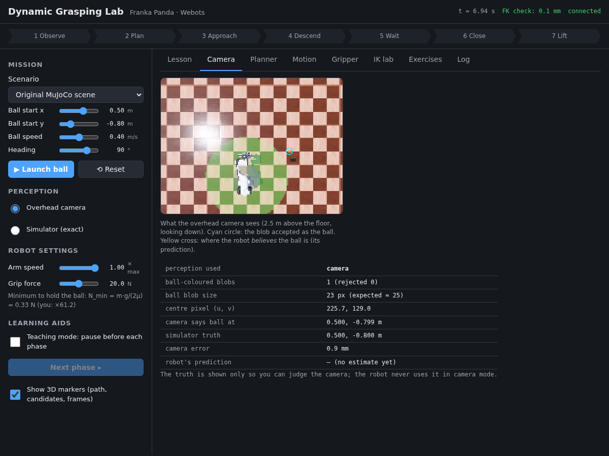
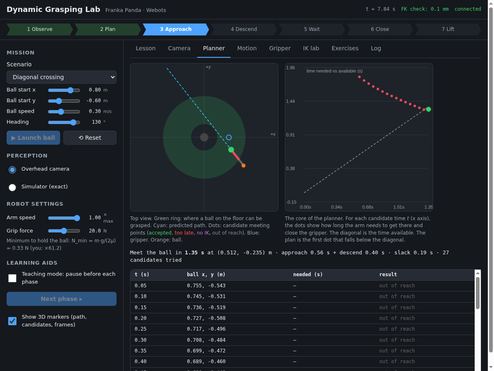
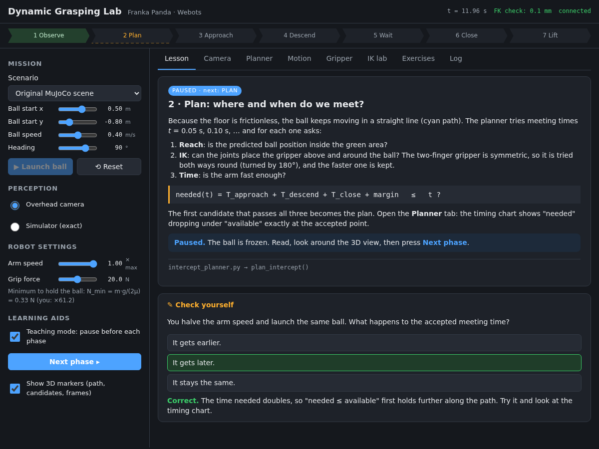
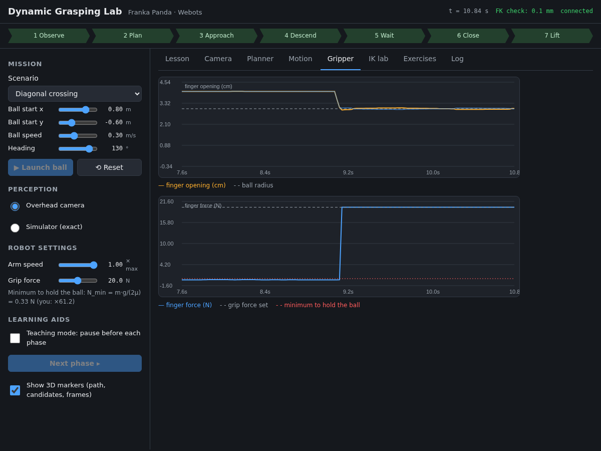

# Dynamic Grasping with the Franka Panda — a Webots teaching example

A ball slides across the floor. A 7-DoF Franka Emika Panda arm **sees** it with a ceiling camera,
**predicts** where it is going, **decides** where and when to meet it, **moves** there in time and
**closes its gripper** at the right instant.

The project is built to be *learned from*: every step of the pipeline is a short, readable Python
file, and a built-in **lesson window** explains each step while it happens, with live plots, a
camera view, quizzes, programming exercises and a teaching mode that freezes the scene before
every phase.

<p align="center">
  
  <br><em>Webots R2025a: the arm catches a ball sliding at 0.4 m/s. Cyan: the predicted path. Red dots:
  meeting points that were too late. Green: the chosen one. Full video: <a href="https://github.com/user-attachments/assets/b0dc7b48-759a-46ce-b6bc-4f6d66073bf1">demo.mp4</a>.</em>
</p>

> 📘 **New here? Start with the User Guide:** open [`docs/user_guide/user_guide.html`](docs/user_guide/user_guide.html)
> in your web browser (or download the [PDF version](https://github.com/haidar996/webots-dynamic-grasping/releases/download/user-guide/Dynamic_Grasping_Lab_User_Guide.pdf)). It covers installing,
> your first catch, a tour of the lab window, teaching mode, the seven phases, experiments, exercises,
> teacher tools and troubleshooting, in 16 illustrated pages.

---

## What you will learn

| Step | Robotics idea | File |
|---|---|---|
| 1 · Observe  | Camera perception: colour segmentation, blob analysis, pinhole back-projection | `perception.py` |
| 1 · Observe  | Estimating velocity from noisy positions (least-squares line fit) | `dynamic_grasping.py` |
| 2 · Plan     | Intercept planning: predict, check reach, check IK, check time | `intercept_planner.py` |
| 2–4          | Forward/inverse kinematics with screw theory (Product of Exponentials) | `kinematics.py` |
| 3 · Approach | Quintic (minimum-jerk) trajectories, joint speed limits | `trajectory.py` |
| 3 · Approach | Joint control: velocity feed-forward + proportional feedback | `dynamic_grasping.py` |
| 3–5          | Tracking while moving, gating, correcting the plan before committing | `dynamic_grasping.py` |
| 4 · Descend  | Pre-grasp poses and grasp orientation | `intercept_planner.py` |
| 5 · Wait     | Timing the gripper closure to a moving object | `dynamic_grasping.py`, `gripper.py` |
| 6 · Close    | Friction grasp: how hard to squeeze, N_min = m·g / (2μ) | `gripper.py` |

The project uses **one** method per step, on purpose: one planner, one trajectory type and one
controller, chosen because they are the easiest to understand. There are no benchmarks and no
comparisons. The goal is to see each idea working inside a complete system.

---

## Running it

**Requirements:** [Webots R2025a](https://cyberbotics.com/) and Python 3 with NumPy
(`pip install -r requirements.txt`). Nothing else: no Pinocchio, no solvers, no compiled code.
The first run downloads the official Webots Panda model and its meshes (about 11 MB); Webots keeps
them in its cache.

This project is part of [webots-projects](https://github.com/cyberbotics/webots-projects). To get
only this folder:

```bash
git clone --depth 1 --filter=blob:none --sparse https://github.com/cyberbotics/webots-projects.git
cd webots-projects
git sparse-checkout set projects/dynamic_grasping_franka
cd projects/dynamic_grasping_franka
pip install -r requirements.txt
```

(Or download the [whole repository as a ZIP](https://github.com/cyberbotics/webots-projects/archive/refs/heads/master.zip)
and open `projects/dynamic_grasping_franka`.)

1. Open `worlds/dynamic_grasping.wbt` in Webots and press ▶ (run).
   The arm moves to its ready pose.
2. **Double-click the robot** (or right-click → *Show Robot Window*) to open the
   **Dynamic Grasping Lab** window. On Linux it opens in your web browser.
3. Pick a **scenario**, press **Launch ball**, and watch.
4. Press **Reset** before launching again. (*Launch* is greyed out until the arm is back home.)

> Tip: start with *Still ball*, then *Gentle roll*, then tick **Teaching mode** and go through
> *Original MuJoCo scene* one phase at a time, answering the quiz on each lesson card.

**Optional controller arguments** (Robot → `controllerArgs` in the scene tree):

| Argument | Effect |
|---|---|
| `--launch=0.5,-0.8,0.4,90` | launch that ball (x, y, speed, heading) as soon as the arm is home |
| `--perception=simulator` | use exact positions instead of the camera |
| `--grip-force=5` | starting grip force in newtons |
| `--script=file.json` | play a list of window commands: a hands-free classroom demo (see `command_script.py`) |
| `--record-movie=demo.mp4` | record the 3D view of the first launch, until just after its result |
| `--exit-on-result` | quit Webots when the catch ends (exit code 0 = caught), for automated checks |

---

## Tour of the lesson window

| Area | What it does |
|---|---|
| **Pipeline bar** (top) | The 7 phases. The current one is highlighted; in teaching mode the next one is outlined. |
| **Mission** | Scenario presets, or set the ball's start position, speed and heading yourself. |
| **Perception** | *Overhead camera* (the robot finds the ball in images) or *Simulator* (exact positions). |
| **Robot settings** | *Arm speed* (fraction of the joint speed limits) and *Grip force* (with the theoretical minimum shown next to it). |
| **Teaching mode** | Pauses **before** each phase and freezes the ball. Press **Next phase** to continue. Nothing is lost: the plan and the predictions are shifted in time. |
| **Lesson** tab | One card per phase: the idea, the equations, the file/function that implements it, and a **check-yourself quiz**. |
| **Camera** tab | What the ceiling camera sees, the blob accepted as the ball, the robot's prediction, and the camera's error against the simulator's truth. |
| **Planner** tab | Top view (reachable area, predicted path, every candidate), the *time needed vs time available* chart, and a table of every candidate with the reason it was rejected. |
| **Motion** tab | Desired (quintic) vs measured joint angle, tracking error, and where every joint sits within its limits. |
| **Gripper** tab | Finger opening and finger force: watch the switch from *position phase* to *force phase*. |
| **IK lab** tab | Choose any gripper pose; see the IK iterations converge and the arm move there. |
| **Exercises** tab | Six programming exercises (see below) and a **Check my exercises** button. |
| **Log** tab | Everything the controller decided, and **CSV export** of the run data and planner candidates. |

<p align="center">
  
  
  <br>
  
  
  <br><em>Screenshots of the lesson window during real Webots runs.</em>
</p>

In the **3D view** you also see the predicted path (cyan), the planner's candidates
(green = accepted, red = too late, purple = no IK), the pre-grasp and grasp target frames
(x red, y green, z blue), the gripper's trail (blue), and on the floor the area where a ball can
be grasped (green ring). The status bar's **FK check** compares the gripper position predicted by
the kinematics code with the one measured in the simulation, so it is a live test of the model.

---

## How it works, in one page

```
 IDLE ─launch─► OBSERVE ─► PLAN ─► APPROACH ─► DESCEND ─► WAIT ─► CLOSE ─► LIFT ─► CAUGHT
                 camera     where     quintic   correct,   timed    force-    check
                 + line fit & when?             then down  closure  limited
```

1. **Observe.** Each camera frame: keep orange pixels → keep the blob shaped like the ball → turn
   its centre pixel into a floor position. Over 0.2 s, fit `p(t) = p₀ + v·t`.
2. **Plan.** The ball slides on a frictionless floor, so it keeps going straight. For meeting times
   t = 0.05, 0.10, … s the planner predicts the ball position and checks:
   *is it reachable?* → *does IK find joint angles for the pre-grasp and grasp poses?* →
   *is `T_approach + T_descend + T_close + margin ≤ t`?* The first time that passes is the plan.
3. **Approach.** A quintic joint-space motion to 12 cm above the meeting point. Meanwhile the camera
   keeps **tracking** the ball and the line fit is refreshed with every frame.
4. **Descend.** First **correct** the meeting point with the latest estimate, then go straight down
   with the fingers open on either side of the ball's path.
5. **Wait.** Close when the ball's predicted time-to-arrival equals the fingers' travel time (≈ 0.05 s).
6. **Close.** The finger target is set *inside* the ball with the motor force capped at the grip
   force: free motion first, then a force-limited squeeze. The two fingers are kept symmetric.
7. **Lift.** Raise the gripper and check that the ball came along.

Every joint, all the time, follows one control law:

```
dq_cmd = dq_desired + K_p · (q_desired − q_measured)
```

The step-by-step version with exercises to try in the window is in
**[docs/LESSONS.md](docs/LESSONS.md)**.

---

## Exercises

Six short "write this function" exercises live in [`exercises/`](exercises/): forward kinematics,
the quintic, one IK step, the velocity fit, the grip force, and pixel-to-floor back-projection. Check
them with the **Exercises** tab or `python3 exercises/check.py`. Each check compares your function
with the code the robot runs and gives a hint when something is off.

---

## Project layout

```
projects/dynamic_grasping_franka/
├── worlds/dynamic_grasping.wbt          the scene: the official Webots Panda with a ceiling camera
│                                        and a TCP GPS, the ball, the frictionless floor
├── controllers/dynamic_grasping/
│   ├── dynamic_grasping.py              state machine, joint controller, tracking, window messages
│   ├── config.py                        every tunable number in one place
│   ├── perception.py                    camera: segmentation, blob analysis, back-projection
│   ├── kinematics.py                    PoE forward kinematics, Jacobian, damped-least-squares IK
│   ├── trajectory.py                    quintic trajectories and their minimum duration
│   ├── intercept_planner.py             forward-scan intercept search
│   ├── gripper.py                       finger control, friction-grasp force, finger coupling
│   ├── command_script.py                plays scripted window commands (demos, automated checks)
│   └── scene_markers.py                 3D teaching markers (paths, candidates, frames, trail)
├── plugins/robot_windows/grasping_window/   the lesson window (HTML / CSS / JS)
├── exercises/                           six exercises + check.py
├── tests/                               offline tests, Webots test runner, GUI end-to-end check
├── docs/LESSONS.md                      the lessons, step by step
├── docs/user_guide/user_guide.html      the user guide (images in docs/images/)
└── PORTING_NOTES.md                     what changed from MuJoCo, and why
```

### Tests (no Webots needed)

```bash
pip install pytest
python3 -m pytest tests -q
```

These check the kinematics against Franka's published DH table, the IK, the quintic limits, the
planner, the camera geometry, the exercise checker, and the controller's whole state machine run
against a small kinematic stand-in for Webots (`tests/fake_webots/`). GitHub Actions runs them on
every change to this project, on Python 3.10–3.13
(`.github/workflows/dynamic_grasping_franka.yml` at the root of webots-projects).

### Tests in real Webots (no clicking needed)

```bash
pip install websockets          # for the lesson-window check
tests/run_webots_tests.sh
```

This runs every preset scenario, a 46-step tour of every window feature (teaching mode, reset,
perception switch, IK lab, grip force, arm speed, markers, exercises, misuse such as launching while
busy), and an end-to-end check of the lesson window itself: headless Chrome loads the real page from
Webots, clicks through it (camera tab, quiz, CSV downloads, …) and reports any JavaScript error.

---

## Where it comes from

This is a teaching-sized port of
[*Dynamic Object Grasping Using a 7-DoF Manipulator*](https://github.com/haidar996/dynamic-grasping-7dof)
(MuJoCo), which compares several planners and controllers (TOPP-RA, CROFT, contractive MPC,
feedback linearisation, sliding-mode control, NMPC). Here one simple method was kept for each
step. [PORTING_NOTES.md](PORTING_NOTES.md) lists what changed in the move from MuJoCo to Webots and
why, including the differences found by testing.

**Authors of the original project:** Alaa Hussein · Haidar Saad (Manara University, supervised by
Dr. Essa Alghannam). The robot is the official Webots Franka Emika Panda model (Apache 2.0).

## License

Apache License 2.0, the license of the [webots-projects](https://github.com/cyberbotics/webots-projects)
repository (and of Webots and its Franka Emika Panda model). Both authors of the original project
agreed to release this port under it.
